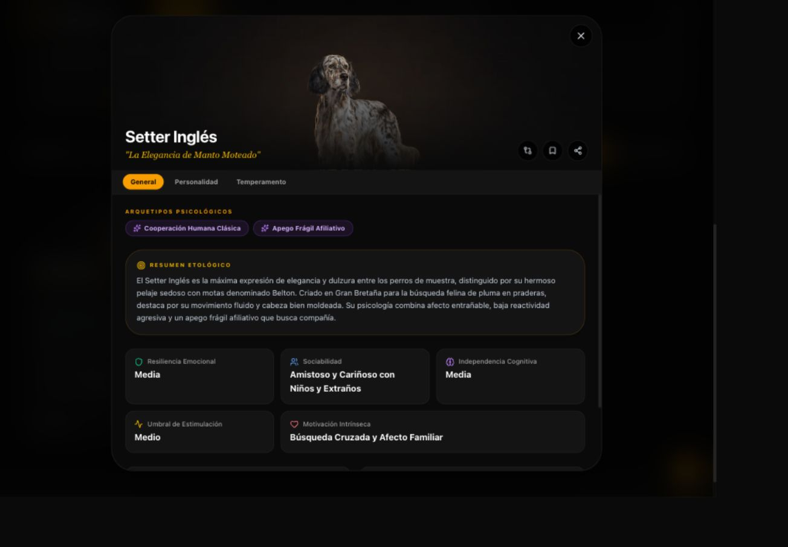
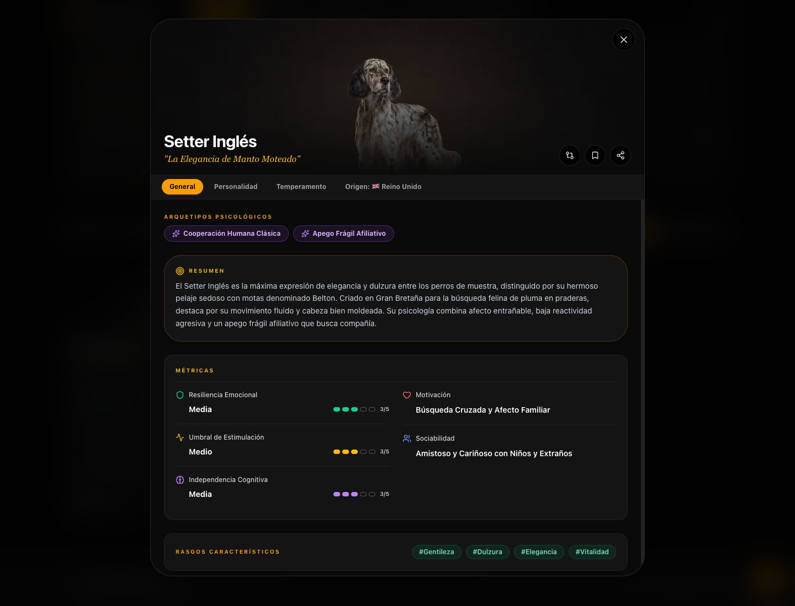
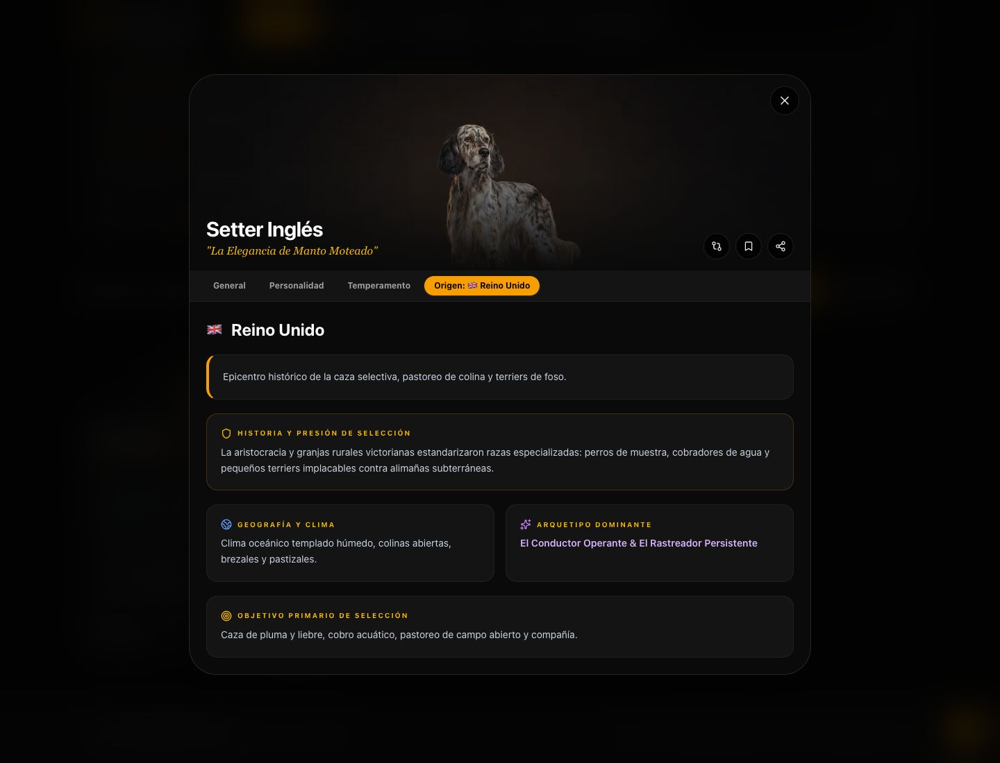
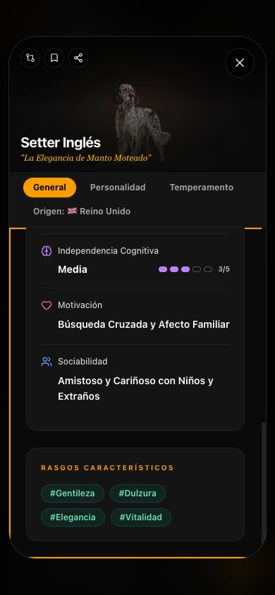
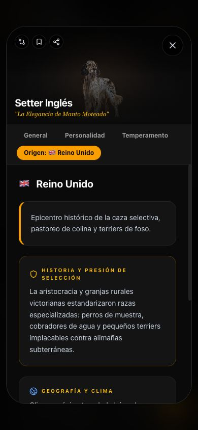
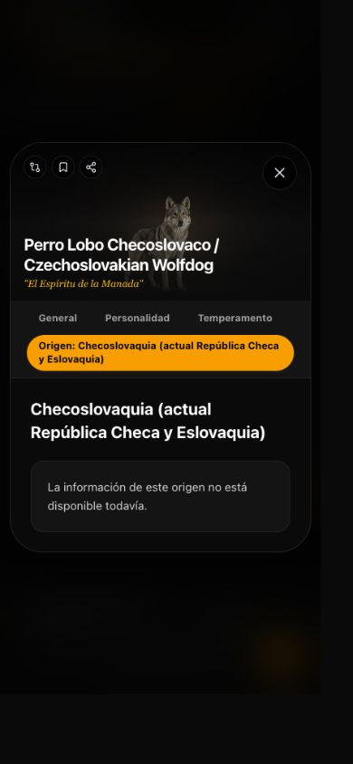

# Rediseño del modal de razas — revisión local

Fecha: 9 de octubre de 2026. Rama: `feature/redesign-breed-modal-origin`.
Base: `df945d5c589445230c6f34bec9d03e7ec6842db3`, comprobada contra `refs/heads/main` de GitHub antes de crear la rama.

Estado: implementación lista para revisión local. No se ha publicado la rama, creado un despliegue, hecho merge ni modificado producción.

## A. Auditoría e implementación

La auditoría encontró un único modal compartido (`src/components/BreedDetailModal.tsx`), abierto desde `src/App.tsx`, con selección, favoritos, comparación y navegación gestionados por el padre. El catálogo activo es `src/data/canineData.ts`: contiene 183 razas. El README conserva cifras históricas y no se utilizó para determinar el catálogo activo.

Cabecera, General, Personalidad y Temperamento estaban dentro de ese mismo componente. Los arquetipos, rasgos, secciones y métricas proceden de cada `Breed`; sus tipos están en `src/types.ts`. Las imágenes se resuelven mediante `breed.imageUrl` y `src/utils/breedImages.ts`.

`BreedCompare.tsx` utiliza `parseMetricScore`, una conversión de texto a una escala de 1–5, para radar, barras, tablas e índice promedio. `dataParser.ts` contiene otro normalizador para categorías y filtros: no sirve para conservar todas las diferencias contextuales como una cifra única.

`OriginsView.tsx` agrupa por el valor literal de `breed.origen` y consulta `COUNTRIES_DATA` en `originsData.ts`. Los campos del mockup existen: nombre/bandera, `summary`, `historicalContext`, `climateAndGeography`, `dominantArchetype` y `primarySelectionGoal`.

La revisión visual inicial confirmó las tarjetas independientes y la clasificación en General. La inspección del navegador confirmó ausencia de roles de diálogo/pestañas y scroll de fondo sin bloquear. Se capturó el Setter Inglés antes de editar. Las referencias del usuario se conservaron sin cambios y no se incluyen en el commit.

### Archivos de código

| Archivo | Cambio |
| --- | --- |
| `src/components/BreedDetailModal.tsx` | General rediseñado, cuarta pestaña, semántica de diálogo/pestañas, gestión de foco, scroll y espacio para flechas en tablet. |
| `src/components/BreedOverviewMetrics.tsx` | Contenedor común de métricas; columnas adaptables; tres indicadores accesibles y dos valores descriptivos. |
| `src/components/BreedOriginPanel.tsx` | Composición de los campos geográficos existentes y estado explícito de información no disponible. |
| `src/utils/breedOrigin.ts` | Consulta exacta de la relación raza-origen, sin inferencias ni datos de respaldo inventados. |
| `src/utils/metricScore.ts` | Conversión original de Comparar extraída sin cambios y detector estricto de niveles inequívocos. |
| `src/components/BreedCompare.tsx` | Importa la misma conversión desde su módulo compartido; presentación y cálculos idénticos. |
| `src/utils/breedModal.test.tsx` | Cuatro pruebas focalizadas, incluidas verificaciones de renderizado sobre las 183 razas. |
| `package.json` | Añade `test:breed-modal`; no añade dependencias. |

Este informe y `docs/reviews/breed-modal-origin/` contienen la evidencia de revisión.

### Cambios aplicados

- Etiquetas «Resumen» y «Motivación» en General. Temperamento conserva sus etiquetas originales, como exige la protección de esa pestaña.
- Resumen conserva exactamente `breed.summary` y su estructura; no se modificó el catálogo.
- Clasificación oficial desaparece únicamente de General. FCI/AKC permanecen en los datos y en las otras funcionalidades.
- Métricas se agrupan en una superficie común: niveles a la izquierda y motivación/sociabilidad a la derecha en escritorio; una columna en móvil.
- Rasgos conserva todos los elementos originales en un bloque independiente, con ajuste de línea.
- Las cuatro pestañas comparten componente, selección y estilos. Los nombres geográficos largos se distribuyen en varias líneas.
- Flechas izquierda/derecha y Home/End recorren las pestañas cuando tienen foco. Fuera de ellas se conserva la navegación entre razas.
- El diálogo bloquea el fondo, contiene el foco, restaura foco/scroll al cerrar y comienza cada pestaña desde arriba.
- Se reservó espacio para las flechas laterales en tablet tras detectar que la composición anterior se superponía al contenido.

Los bloques de Personalidad y Temperamento se compararon literalmente contra la base y son idénticos. No se editaron `App.tsx`, los datos, estilos globales, imágenes, filtros, Test de Afinidad ni la sección original de Origen.

## B. Integración de datos

### Origen

La consulta utiliza la clave exacta del catálogo y devuelve la misma referencia a `COUNTRIES_DATA`, sin copiar los textos. Razas con el mismo origen comparten la fuente. Los cinco campos editoriales se muestran íntegros.

Se conservaron las convenciones existentes para Bélgica / Francia y Alemania / Suiza (🇪🇺), Tíbet (🏔️) y Oriente Medio (🏜️). No se dividieron orígenes ni se reasignaron países.

Diez razas no tienen una entrada específica en `COUNTRIES_DATA`:

| Raza | Origen literal |
| --- | --- |
| Pastor de Asia Central / Central Asian Shepherd Dog (Alabai) | Asia Central (regiones de la antigua URSS) |
| Vallhund Sueco / Swedish Vallhund | Suecia |
| Chinook | Estados Unidos (New Hampshire) |
| Mountain Cur | Estados Unidos (regiones montañosas del sur) |
| Lundehund Noruego / Norwegian Lundehund | Noruega (isla de Værøy, archipiélago de Lofoten) |
| Pastor Islandés / Icelandic Sheepdog | Islandia |
| Perro Lobo Checoslovaco / Czechoslovakian Wolfdog | Checoslovaquia (actual República Checa y Eslovaquia) |
| Perro del Faraón / Pharaoh Hound | Malta |
| Skye Terrier | Escocia (isla de Skye) |
| Ridgeback Tailandés / Thai Ridgeback | Tailandia |

El usuario autorizó mostrar el nombre literal y «La información de este origen no está disponible todavía.», sin bandera deducida ni bloques de relleno. La sección original de Origen conserva su comportamiento previo; el nuevo modal no replica sus textos genéricos de respaldo.

### Escalas

Solo se admite un valor completo e inequívoco. Se reutiliza la escala de Comparar: Muy baja/o = 1, Baja/o = 2, Media/o = 3, Alta/o = 4, Muy alta/o y Extrema/o = 5. La equivalencia de Muy alta y Extrema ya existe en Comparar; ambas etiquetas originales siguen visibles.

Los indicadores tienen cinco segmentos, cifra visible `n/5`, etiqueta literal y rol `meter` con nombre y descripción accesibles. Los segmentos activos tienen relleno y los inactivos solo contorno: la lectura no depende exclusivamente del color.

Por decisión expresa del usuario, los intervalos y descripciones contextuales no reciben cifra ni indicador único. Ejemplos: «Media–Alta», la resiliencia contextual del Azawakh y «Muy Alto (Visual/Auditivo) / Muy Bajo (Olfativo)» del Basset Hound. No se recorta ni se normaliza el texto mostrado. Motivación y Sociabilidad son exclusivamente descriptivas.

## C. Validaciones

| Comprobación | Resultado |
| --- | --- |
| `npm run build` | Correcto. Persiste advertencia de bundle principal superior a 600 kB; no impide compilar. |
| `npm run test:breed-modal` | 4/4 correctas. Comprueba todas las 183 razas, texto completo, indicadores y datos geográficos/ausencias. |
| `npm run test:affinity` | 13/13 correctas. |
| `npx tsc --noEmit --types node,react,react-dom,google.maps` | Correcto. |
| `npm run lint` | Bloqueado por los errores preexistentes TS2688: `d3-array 2` y `d3-interpolate 2` en el entorno de dependencias. No se presenta como aprobado. |
| `git diff --check` | Correcto. |
| Comparación literal de Personalidad/Temperamento | Sin diferencias en sus bloques. |
| Conversión y presentación de Comparar | Conversión extraída idéntica; resto del componente idéntico. |
| Consola del navegador en la sesión validada | Sin errores ni advertencias observados. |

### Muestras reales y resoluciones

Se eligieron extremos del catálogo: Grifón de Muestra de Pelo Duro tiene el nombre más largo (60 caracteres); Pinscher Miniatura, el epíteto y motivación más largos (41 y 45); Fila Brasileiro, el resumen más largo (628); Bull Terrier, sociabilidad más larga (56); Grifón de Bruselas, 10 rasgos; Perro Lobo Checoslovaco, la denominación geográfica más larga (52).

Muestras: Setter Inglés; Grifón de Muestra de Pelo Duro / Wirehaired Pointing Griffon; Pinscher Miniatura; Fila Brasileiro / Mastín Brasileño; Bull Terrier; Grifón de Bruselas / Brussels Griffon; Crestado Chino (Chinese Crested); American Pit Bull Terrier; Perro Lobo Checoslovaco / Czechoslovakian Wolfdog; Basset Hound; Azawakh; Basenji; Papillon (Epagneul Enano Continental); Mastín Tibetano; Saluki (Galgo Persa); Chinook; Puli; Boyero de Flandes; Landseer.

- Escritorio: 17 primeras muestras a 1440 × 1000 CSS px; capturas finales a 1440 × 1100.
- Tablet: 19 muestras a 768 × 1025 durante desarrollo y nuevamente las 19 a 768 × 1024 sobre el build final, tras corregir el espacio de las flechas.
- Móvil: 19 muestras a 390 × 845 durante desarrollo; prueba final de scroll y Origen a 390 × 844. Nombre más largo probado además a 320 × 568.
- Las dimensiones son las medidas con `innerWidth/innerHeight`; el navegador tenía zoom por origen durante parte de la auditoría. No se confunden con el tamaño solicitado al contenedor del navegador.

En las muestras no se detectaron desbordamiento horizontal en General/Origen, texto recortado por ancho ni superposición del título con el cierre en móvil. Los resultados por muestra están en [browser-qa.json](breed-modal-origin/browser-qa.json). La cobertura de 183 razas es automatizada; no se afirma haber inspeccionado visualmente las 183 fichas.

### Recorrido funcional

1. Apertura desde el buscador: correcto, ficha correspondiente y foco en cierre.
2. General: correcto, nuevos rótulos, métricas y rasgos íntegros; clasificación ausente.
3. Pestañas: correcto por clic y teclado; las flechas en la navegación de pestañas no cambian de raza.
4. Origen: correcto para países, denominaciones especiales y ausencia explícita; comienza arriba al activarse.
5. Personalidad/Temperamento: contenido renderizado y navegación correctos, código específico sin cambios.
6. Anterior/siguiente: correcto por botones y flechas fuera de las pestañas; vuelve a General y mantiene el retorno de foco al cierre.
7. Scroll: correcto, contenedor interno alcanza el final en móvil (673 px en Setter Inglés), sin scroll del fondo; nuevo panel comienza en 0.
8. Cierre y foco: Escape y botón correctos; Tab/Shift+Tab contenidos; se restauran fondo y botón «Ver Detalles».
9. Favoritos y selección para Comparar: correctos; se deshicieron las selecciones de prueba. La herramienta independiente mostró radar, tabla y puntuaciones esperadas.
10. Origen independiente: carga del mapa, selección de Alemania y vista Pasaportes correctas.

### Límites de las pruebas

No se realizó una certificación de accesibilidad ni una sesión con lector de pantalla. Se verificaron semántica, teclado, foco e indicadores y se inspeccionaron las capturas.

El gesto táctil físico de swipe no pudo simularse con la API de navegador disponible; se conservó su lógica y se excluyeron los controles interactivos para evitar conflictos. No se realizó envío externo desde Compartir; su manejador original se conservó y se probó la activación del control. No se validaron otros navegadores o dispositivos físicos.

La corrección de flechas se verificó a 768 × 1024: contenido entre x=81 y x=687, flecha izquierda entre x=16 y x=72 y derecha entre x=696 y x=752, sin intersección.

## D. Revisión visual

Los mockups se usaron como composición, manteniendo superficies `#0A0A0A`/`#141414`, tipografía del sistema, iconos Lucide y acentos ámbar/esmeralda/púrpura existentes. Se mantuvieron cabecera, imagen, nombre y epíteto. Los indicadores tienen cinco segmentos, no tres; las alturas son flexibles. El arquetipo geográfico es texto descriptivo, no un enlace inventado.

Las capturas antes/después muestran la composición; no son una comparación píxel a píxel porque las dimensiones de las capturas difieren. Las capturas fueron abiertas e inspeccionadas antes de incorporarlas.

### General anterior



### General final



### Origen final



### Móvil: métricas, rasgos y Origen




### Casos excepcionales




## E. Entrega y pendientes

- Rama local: `feature/redesign-breed-modal-origin`.
- Commit: el commit de entrega que incluye este informe; su identificador se entrega en el mensaje de cierre.
- Build local servido en [http://127.0.0.1:3001/](http://127.0.0.1:3001/). Solo accesible en este equipo y mientras el proceso esté activo.
- Comando de reinicio desde cualquier carpeta:

  ```sh
  npm --prefix '/Users/ramonvallejosmunoz/Desktop/ramon/Perros/atlas-de-personalidades-caninas' run preview -- --host 127.0.0.1 --port 3001
  ```

- Preview de Cloudflare: no creada. El repositorio no tiene configuración de despliegue que permita garantizar el aislamiento; el panel de Cloudflare solicita autenticación. La consulta de estado del commit base en GitHub mostró además una integración Vercel, sin aportar garantías sobre la política de ramas en Cloudflare.
- No se subió la rama, porque un push podría disparar integraciones cuyo aislamiento no se pudo comprobar. No se modificaron configuración, dominios, DNS, variables ni infraestructura.
- Para una Preview remota, falta acceso de lectura a la configuración del proyecto de Cloudflare y confirmar que esta rama se despliega exclusivamente como Preview. No hace falta resolverlo para revisar la versión local.
- Pendiente del usuario: revisión visual del resultado. Las dos decisiones sobre ausencias geográficas y métricas ambiguas ya fueron respondidas y aplicadas.

La integración en `main` y cualquier publicación en producción requieren autorización explícita posterior.
